# Shamanic Forest & Earth

A WordPress plugin that gives the **NativeChurch** theme a "Forest & Earth" look: deep forest green, gold and cream, with a shamanic feel. It is built for [shamanic-reiki-healing.com](https://www.shamanic-reiki-healing.com/).

**Current version:** 3.4.10 · Requires WordPress 6.0+ and PHP 7.4+ · MIT (see [LICENSE](LICENSE))

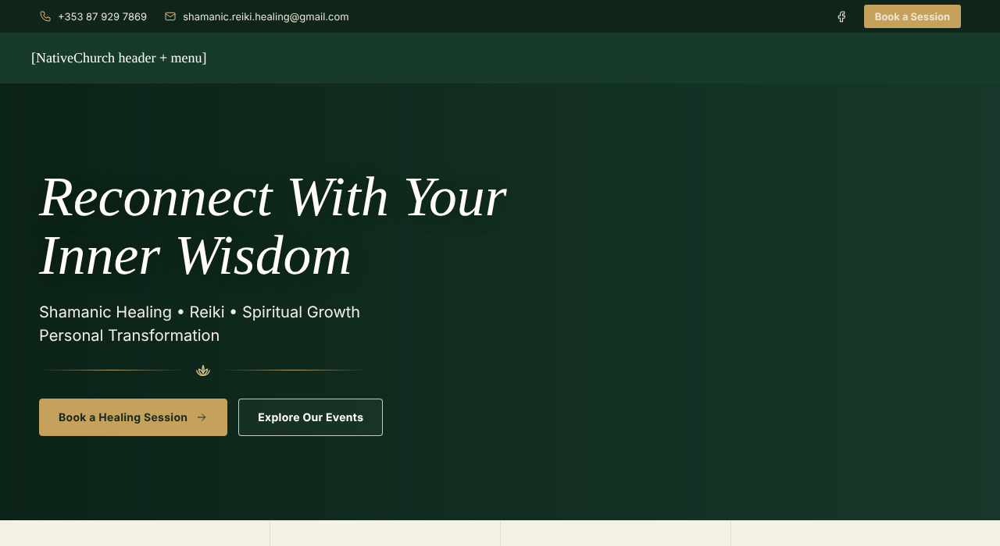

## Live site

These screenshots are taken from the live site, so they update automatically:

| Desktop | Phone |
|---|---|
|  |  |

## Features

- **Homepage template** with a hero, services, an "About" block, upcoming events, a review slider and a newsletter panel.
- **Top bar** with phone, email, Facebook and a *Book a Session* button.
- **Custom footer** with a pine treeline. The theme's footer widgets are not used.
- **One consistent style on every page:** headings, breadcrumbs, sidebars and buttons.
- **Booking form** `[sfe_booking_form]`, built with Contact Form 7. It uses the full width, with two fields per row.
- **Newsletter signup** `[sfe_newsletter_form]`. It adds subscribers straight to a MailPoet list, uses a nonce and a spam honeypot, and sends MailPoet's confirmation email.
- **Events list** `[sfe_events]`, shown automatically on the Events page. Upcoming events are cards grouped by month; past events sit in a collapsible list.
- **Event pages:** styled "Event details" panel and share icons, plus a *Book your place* box. The **Book a place** button opens the booking form with the event already filled in.
- **Mobile menu:** tap to open a submenu, marked with a gold chevron.
- **Speed:** critical CSS, SVG icons with fixed sizes (no icon flash while the page loads) and none of the theme's old Google Fonts.
- **Theme guard:** blanks a broken *Custom JS* value in the theme options.
- **Hides Jetpack "Like" buttons**. This can be switched in settings.
- **Social share images:** pages without a featured image show Forest & Earth artwork in Facebook, WhatsApp and X previews (Rank Math).

## Screenshots

| | |
|---|---|
| 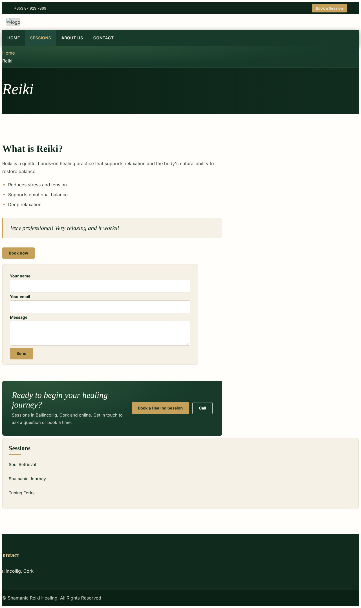 | 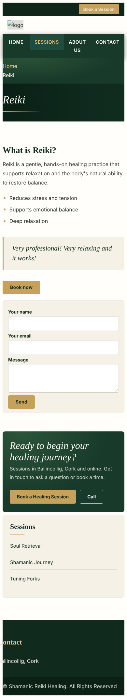 |
| 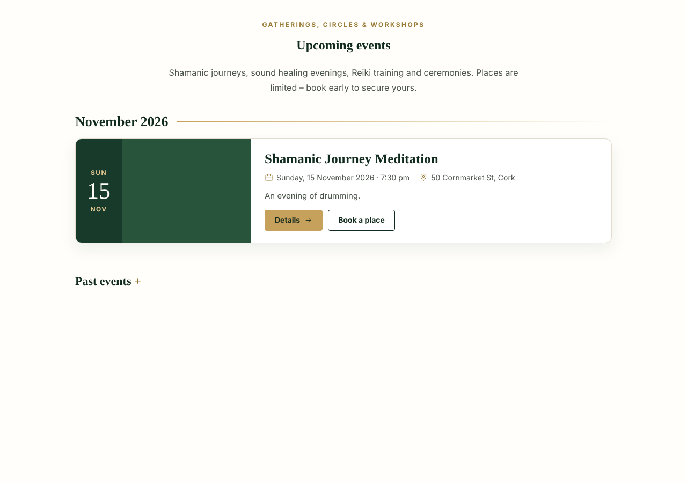 | 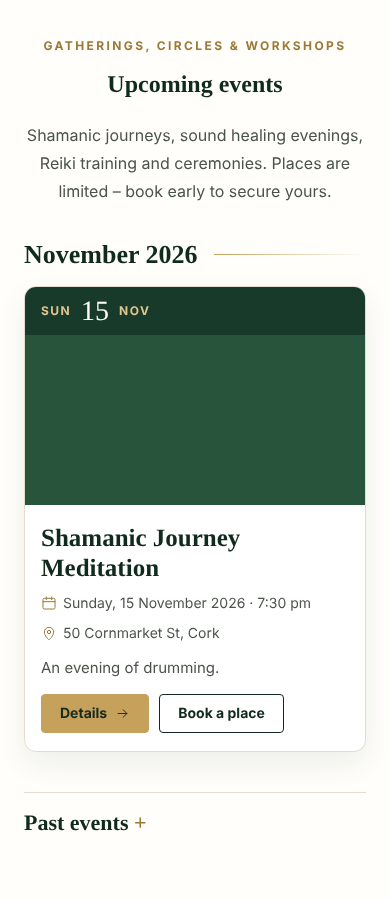 |
| 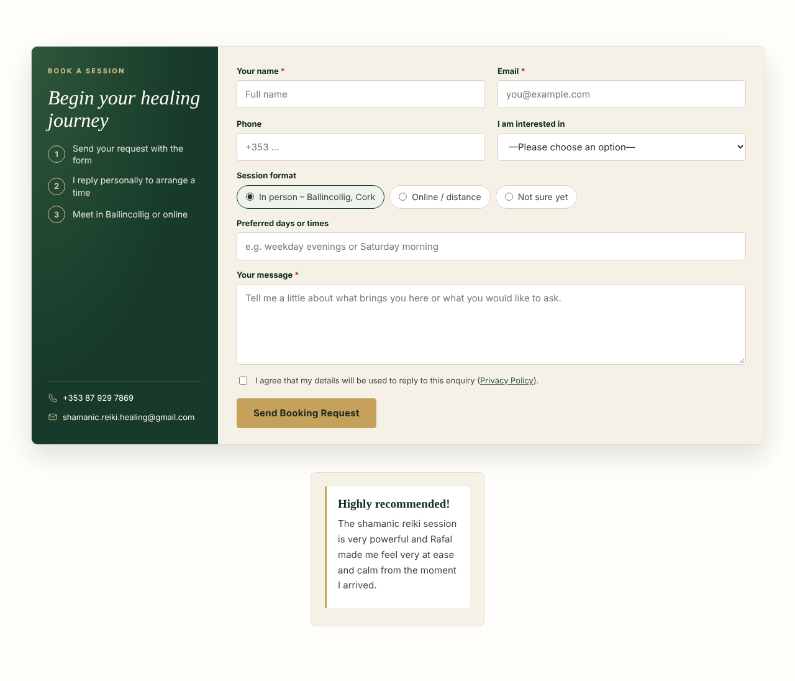 | 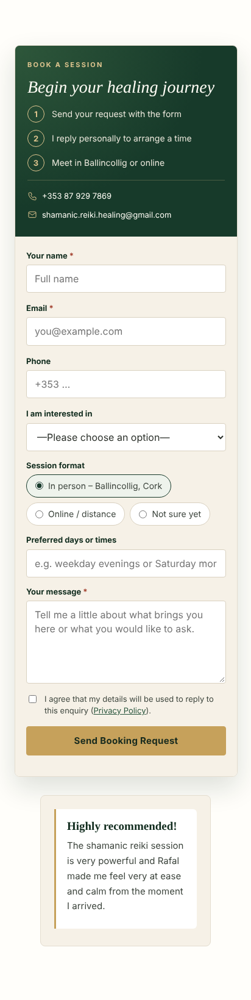 |
| 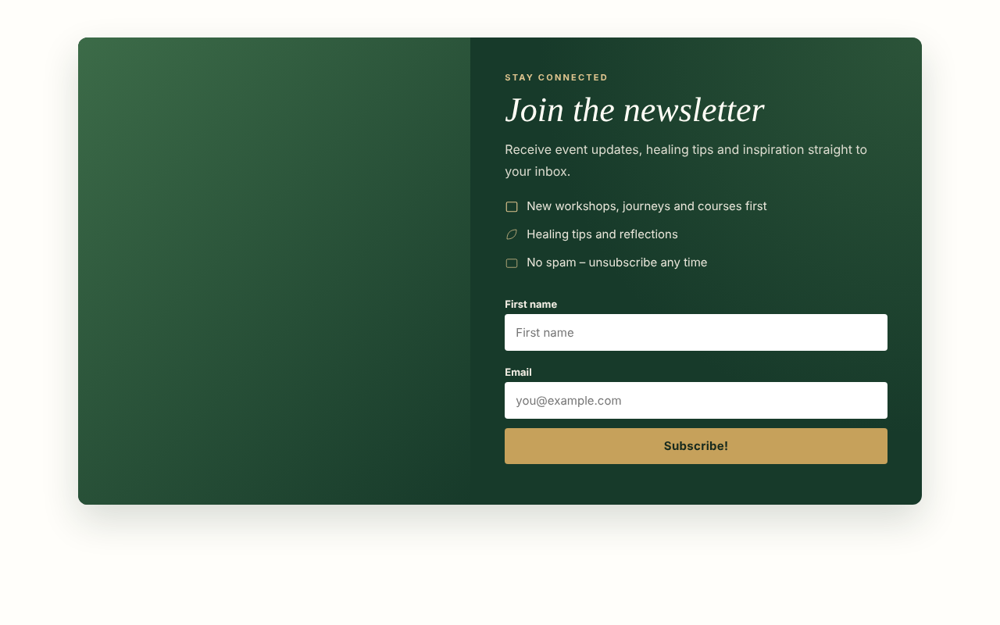 | 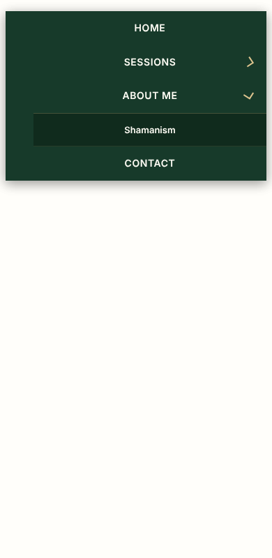 |
| 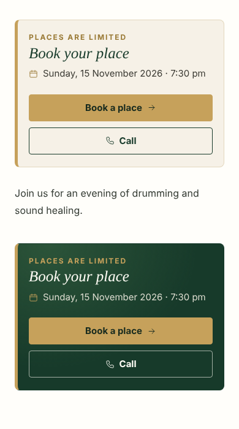 | |

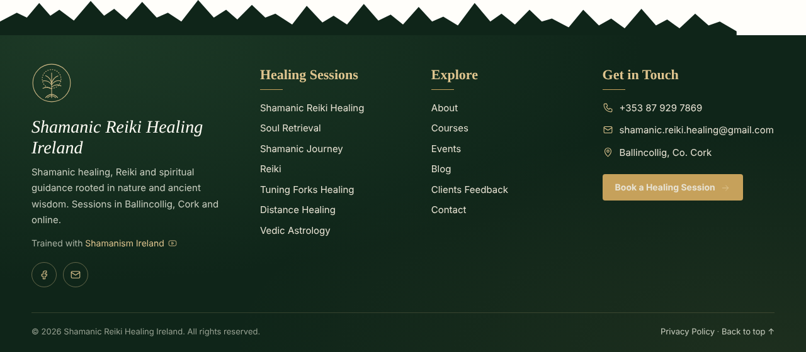

> The screenshots in `screenshots/` come from a local test render, so the theme header is a placeholder and some photos are missing. The site itself shows the real header and images.

## Installation

1. Download `releases/shamanic-forest-earth-3.4.10.zip`.
2. In WordPress, go to **Plugins → Add New → Upload Plugin**, choose the ZIP and click **Install Now**. If an older version is installed, choose **Replace current with uploaded**.
3. Activate the plugin. You can then change its options under **Settings → Forest & Earth**.

### Shortcodes

| Shortcode | What it shows |
|---|---|
| `[sfe_booking_form]` | Session booking / contact form (needs Contact Form 7) |
| `[sfe_newsletter_form]` | Newsletter signup (needs MailPoet) |
| `[sfe_events]` | Events list: upcoming events by month, past events collapsible |

## Changelog

See [`shamanic-forest-earth/readme.txt`](shamanic-forest-earth/readme.txt).
